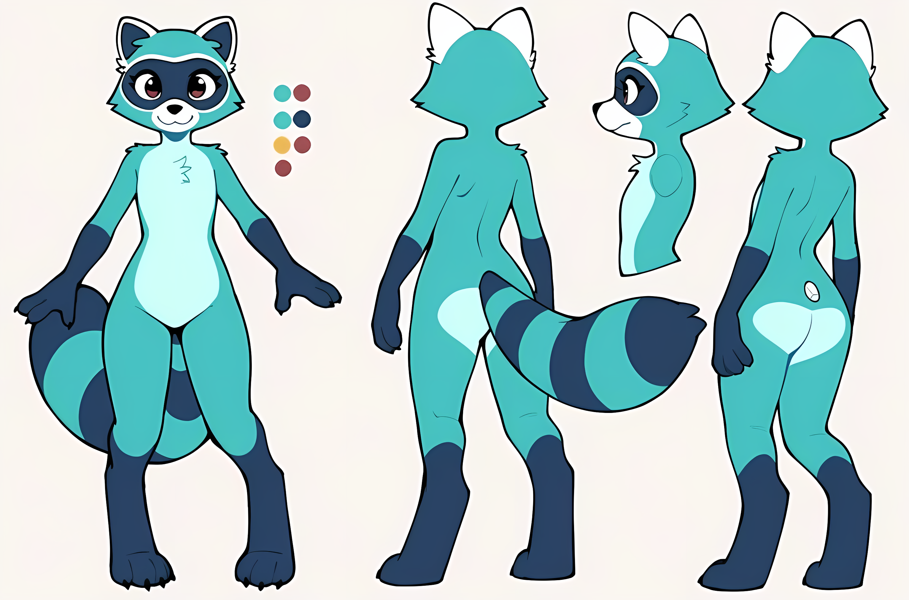
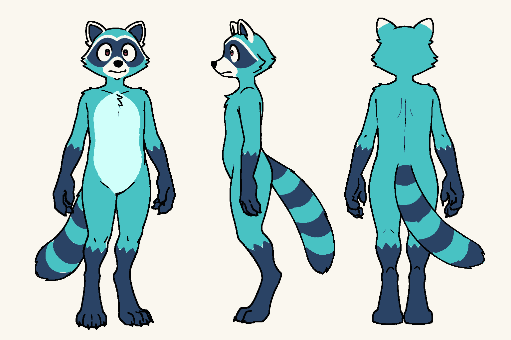

# Raccoon style guide

How the raccoons of *Rest* look: the rules every raccoon follows, and what sets male and female raccoons apart. These two sheets are the references, and every new raccoon image should match them.

| Female reference | Male reference: Enoch |
| --- | --- |
|  |  |
| [female-raccoon/baseline-highres.png](female-raccoon/baseline-highres.png) | [enoch-sheet/enoch_character_sheet.png](enoch-sheet/enoch_character_sheet.png) |

Enoch's full rules, and how his sheet was made, are in [enoch-sheet/enoch-rules.md](enoch-sheet/enoch-rules.md). The female raccoon's rules, and what her Forge jobs have taught us, are in [female-raccoon/female-rules.md](female-raccoon/female-rules.md). New raccoon art is made through Forge jobs, each reviewed before it runs: see [Making and changing raccoon art](#making-and-changing-raccoon-art).

## Shared rules

Every raccoon, male or female, follows these.

### Body

- Anthro: upright and humanoid, with usable hands, while keeping a raccoon's build, mask, and tail.
- **Adult proportions.** The head, ears included, is about a fifth of total height (0.19–0.21). Fingertips reach mid-thigh, and legs are nearly half the body.
- **Digitigrade.** Raccoons stand on their toes, on raccoon hind paws. Never flat feet, never shoes.
- Big, round, friendly eyes. A calm expression: never angry or scowling.

### Palette

Sampled from flat areas of the female reference. Every raccoon uses exactly these colours.

| Part | Colour |
| --- | --- |
| Fur | Teal `#48C2C3` |
| Mask, hands, lower legs, tail rings | Navy `#2A4365` |
| Muzzle, chest, belly | Mint `#D0FFFA` |
| Inner ears, eye whites | White |
| Iris | Red-brown `#8D3F4C` |
| Outlines | Near-black `#020304` |
| Sheet background | Off-white `#FAF7EF` |

### Markings

- **Mask:** a navy band across the eyes, edged above and below with a thin pale line.
- **Hands:** navy on the forearms and hands (the "sleeves"). The edge where the navy starts differs by sex: see below.
- **Legs:** navy from halfway up the calf, just below the knee, with a short jagged fur edge where it meets the teal.
- **Chest:** a mint patch from the throat to the belly, with a small fur flick near the top.
- **Shoulder fur:** small spiky tufts stick out where the neck meets each shoulder.

### Tail

- Big and fluffy, about as long as the leg.
- **Exactly four navy rings.** The first sits at the base of the tail and the last one is the tip: navy, teal, navy, teal, navy, teal, navy tip.
- Rings are smooth, even bands, not zigzags.
- The same length and pattern in every view.

### Eyes

- Round white eyes with a black pupil.
- The lower part of the pupil is red-brown, with a small white shine at the top.

### Line and style

- Flat colours, clean bold outlines, cartoon style. No gradients or painted shading.
- Outlines are about a third of a percent of figure height: on a figure about 1,900 px tall, roughly 6 px.

### Sheet layout

- Three views: front, side (with the tail showing), and back, with the side view in the centre. One side view only. Each figure is clearly separated, with nothing overlapping.
- Plain off-white background. No text, props, or clothing on a base-body sheet.
- A plain cartoon body with no anatomical detail.

## Female and male differences

Everything above is shared. These features are what make a raccoon read as female or male. They are the first thing to check when a generated image reads as the wrong one.

| Feature | Female | Male |
| --- | --- | --- |
| **Torso** | A mild hourglass: the waist pinches in gently, and the hips are a little wider than the waist. A simple cartoon body, never a pin-up. | **Square:** the sides run in a mostly straight line from shoulders to hips. No waist. |
| **Hips and thighs** | Hips a little wider than the waist. In prompts say `mild waist, soft rounded body, wider hips`, not `hourglass figure`, `wide hips` or `full thighs` (see [female-rules.md](female-raccoon/female-rules.md)). | Narrow, straight hips. |
| **Shoulders** | Narrower than the hips. | **Wide:** nearly as wide as the thighs. The sides run almost straight from shoulder to knee, easing out a little at the thighs. |
| **Sleeves** (where the navy on the arm meets the teal) | A flat, even edge. | A zigzag fur edge. |
| **Height** | The baseline. | About 5% taller than the female. |
| **Eyes** | Large dark pupils with eyelashes on the upper lids. | Smaller pupils. No eyelashes. |
| **Face** | Rounder, with a wider smile. | Squarer jaw, a calmer and flatter mouth. |
| **Back view** | A mint patch across the back of the hips, and a visible curve at the small of the back. | All teal from neck to legs. No mint patch, and a flat back. |
| **Stance** | Weight can shift to one side, with a softer pose. | Upright and squared, with weight on both feet. |

The most important male rule is the **square torso**. Without it, male raccoons drift toward the female silhouette, even when every other rule is met.

## Making and changing raccoon art

Every raccoon image is made or changed in Forge, through the job pipeline in [tools/forge_jobs.py](tools/forge_jobs.py). Josh only has to ask for the change: Claude runs every step below and stops only for his approval and his verdict (see [CLAUDE.md](../CLAUDE.md)). No image is fixed by hand or by a script that edits pixels. If an image breaks a rule, change the prompt, mask, guide or settings and generate it again.

### Steps for every job

Each step is `py art/tools/forge_jobs.py <step> <job>`, run from the repo root by the agent or by Claude.

| Step | Who | What happens |
| --- | --- | --- |
| 1. `new` | [forge-asset-generator](../.claude/agents/forge-asset-generator.md) agent | Makes `art/jobs/<id>/job.json`. Fill in the **goal** (what should change) and the **why** (why these settings should do it). |
| 2. `explain` | forge-asset-generator | Writes `explain.md`: what Forge will do, the model, LoRAs, seed, the full prompt, and what changed since the last job. |
| 3. `brief` | forge-asset-generator | Writes `prompt-brief.md` for the reviewer. It opens with the reason for the change, then lists the rules, images and earlier jobs to check. |
| 4. Prompt review | [forge-prompt-reviewer](../.claude/agents/forge-prompt-reviewer.md) agent | Reviews the job independently against the stated reason and this guide, and writes `prompt-review.md`: will help, partly, won't help, or can't tell, with recommendations. |
| 5. `respond` | Claude | Agrees or disagrees with the review, with a reason. **A disagreement goes to Josh** before anything else happens. |
| 6. `approve` | Josh, in chat | Claude sums up the job, the review and its response. Josh replies to approve, and Claude records his exact words with `--chat`. Approval never comes from an agent. |
| 7. `run` | forge-asset-generator | Sends the job to Forge. Images are saved to `art/jobs/<id>/out/` exactly as Forge returns them. The agent then checks each image against the goal and the checklist, as advice for Josh's verdict. |
| 8. `verdict` | Josh, in chat | Josh says **on-track** or **off-track** after checking the images against the checklist below. Claude records it with his words. |

The generator and the reviewer are separate agents, so no job reviews itself. The generator never reviews, approves, gives verdicts or edits pixels, including guides and masks: those come from Josh.

Changing a job, its parent image or its mask after any step sends it back to `explain`, so a revised prompt always gets a fresh review. An upscale has no prompt, so it skips steps 3–5.

### Models and LoRAs

Jobs may only use what's on the approved list in [tools/forge-approved.json](tools/forge-approved.json). `explain` stops any job that names something else, or something Forge doesn't have installed. Only Josh adds to the list.

| Type | Name | Use |
| --- | --- | --- |
| Model | `indigoVoidFurryFusedXL_noobaiV35_fp16.safetensors` | The required model for every character. Every job must set it. |
| LoRA | `charsheet_lora_v1` at 0.6, trigger word `charsheet` | **Only for character sheet requests** (front, side and back on one sheet). Never for single views, close-ups or props. |
| ControlNet | `diffusion_pytorch_model_V2` | Canny / edge guide: locks outline, pose and layout to a guide image. |
| ControlNet | `ip-adapter-plus_sdxl_vit-h` | Reference image: carries a character's look and colours over without copying the layout. |

Every job also states its `kind`: `character-sheet`, `single-character`, `prop` or `other`. The charsheet LoRA is refused on any job that isn't a `character-sheet`.

### Known faults of the model

Indigo Void has these faults with every raccoon, male or female. Images are kept exactly as Forge returns them, so each fault has to be prevented or fixed in Forge.

| Fault | What to do in Forge |
| --- | --- |
| **Grey fur instead of teal**, even when teal is asked for | Strengthen the teal fur words, and put `grey fur` and `charcoal grey` in the negative. Use "navy", never "charcoal grey", for the markings. Regenerate when it still happens. |
| **Small heads and a realistic furry style** without an edge guide (heads about 0.13 of height instead of 0.19–0.21) | Use img2img from an approved sheet with the right head size (the female recipe kept heads at 0.21), or a canny edge guide (`diffusion_pytorch_model_V2`) shaped for that character. A prompt alone doesn't fix it. |
| **A human body** (pin-up or chubby human proportions, human hands, a human backside) in txt2img sheets, whatever the body wording says | For a sheet, use **img2img from an approved sheet** that already has the right body, at denoise 0.6–0.7. Add a fur-and-paws chunk (`fluffy fur, shoulder fur tufts, raccoon paws, paw-like hands with short stubby fingers, soft furry silhouette, simple shapes, minimal interior lines`) and put `human, (human-like:1.2), human proportions, skin-tight` in the negative. This worked for Enoch (`enoch-sheet-005-less-human`) and for her (`female-raccoon-003-img2img-sheet-recipe`). |
| **Censor mark on the lower back**, set off by anatomy words in the negative prompt | Keep the negative to `nsfw` and general terms. Don't list body parts. |
| **Hollow, ring-shaped pupils** | Ask for solid black pupils with a red-brown lower half, or inpaint the eyes. |

### Edge guides are per character

An edge guide fixes the silhouette, so it has to match the character's sex and build. Enoch's guide ([enoch-sheet/shoulder_guide_3pose_v2.png](enoch-sheet/shoulder_guide_3pose_v2.png)) is male: a square torso and wide shoulders. **Use it only for Enoch.** On a female job it pushes her toward a male body. The female raccoon's guide is her own reference sheet: the canny ControlNet runs on it at generation time. In two txt2img jobs it didn't visibly shape her figures, and her proven sheet recipe uses img2img from her sheet instead (see [female-raccoon/female-rules.md](female-raccoon/female-rules.md)). In txt2img without any guide, expect the small-head fault. Josh makes guides; they're never edited by script.

### Small jobs first

- A **small** job makes up to 4 images, with no hires fix and no upscale. Each one should test a single change, so the results show what worked.
- A **large** job (more images, hires fix, or an upscale) runs only if it follows a small job on the same asset and track that Josh marked on-track.

### Tracking images

- `lock <image> --chat "<Josh's words>"` keeps a winner. Josh picks it in chat, and the image is copied byte for byte from the job's `out/` folder (which git ignores) to `art/locked/<asset>/` (which git tracks) and marked locked. Locked images are never changed. A change to one is a new job with the locked copy as its parent.
- `status <image> exploration|candidate|rejected` sets where any other image stands. Changing a locked image's status needs Josh's words too.
- `list` shows every job and the step it's waiting on.
- `gallery` writes `art/gallery.html`, which shows every image grouped by job, with its status and Forge settings.

## Checklist

Check every new raccoon image against this before it's used.

1. Colours match the palette, with nothing extra.
2. Head about a fifth of height, standing on toes.
3. Navy from mid-calf, navy hands, a navy mask with pale edges.
4. Tail: four navy rings from base to tip.
5. Shoulder tufts, and a mint chest with a fur flick.
6. Eyes: red-brown lower pupil with a white shine.
7. A cartoon raccoon body, not a human one, that matches the sex: a mild hourglass and flat sleeve edges for female; square torso, shoulders nearly as wide as the thighs, and zigzag sleeve edges for male.
8. Clean, flat style with nothing extra on the sheet.
